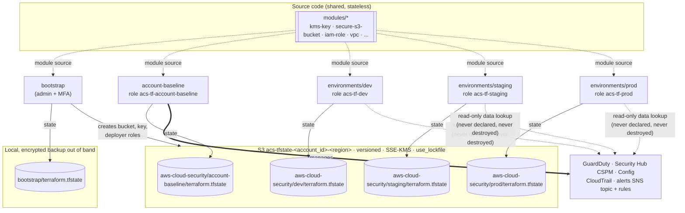

# AWS Cloud Security

This repository holds the Terraform for a security-hardened AWS footprint:

* an **account-level security baseline**: GuardDuty, AWS Security Hub CSPM,
  AWS Config, multi-Region CloudTrail and shared alerting;
* three **environments** (`dev`, `staging`, `prod`) built from the same
  reusable modules: VPC, subnets, route tables, security groups, VPC Flow
  Logs, IAM roles, KMS keys, secure S3 buckets and CloudWatch log groups.

```
aws-cloud-security/
├── bootstrap/            # S3 state bucket, state KMS key, deployer roles (LOCAL state)
├── account-baseline/     # account-level security services (one state per account)
├── environments/
│   ├── dev/              # identical code, own backend key + terraform.tfvars
│   ├── staging/
│   └── prod/
├── modules/              # reusable source code (no state of its own)
│   ├── kms-key/  secure-s3-bucket/  cloudwatch-log-group/  iam-role/
│   ├── vpc/  security-groups/
│   └── guardduty/  securityhub/  aws-config/  cloudtrail/  security-alerting/
├── backend-config/       # <account_id>-<region>.s3.tfbackend, generated by bootstrap
├── tests/mocks/          # shared mock data for `terraform test`
├── scripts/validate-ownership.py
└── docs/terraform-state-ownership.md
```

Requirements: Terraform ≥ 1.11 (tested with 1.16), AWS provider `~> 6.0`,
AWS CLI v2, Python 3 for the validator.

---

## Terraform State Ownership and Deployment Boundaries

Each root module has **its own state** and **its own deployment role**. Each
AWS resource is managed by **exactly one** of them. The full ownership table,
the reasoning, and the cleanup procedures are in
**[docs/terraform-state-ownership.md](docs/terraform-state-ownership.md)**.



**How to read it**

* Solid arrows show **state**. Five roots write to five separate locations.
  Bootstrap is local because it creates the bucket the others use.
* Dotted arrows from `modules/*` show **code reuse**. Every root that calls a
  module gets its own copies of the resources, in its own state.
* Environments only **look up** the baseline (GuardDuty detector, alerts
  topic) with data sources. They never declare it, so destroying an
  environment cannot reach it. The environment deployer roles are also
  explicitly denied any change to it.

| Root module | Backend | State key | Authorized role | Owns |
|---|---|---|---|---|
| `bootstrap/` | `local` | `bootstrap/terraform.tfstate` (file) | account admin (MFA) | state bucket and KMS key, deployer roles, workload boundaries, `.tfbackend` file |
| `account-baseline/` | `s3` | `aws-cloud-security/account-baseline/terraform.tfstate` | `acs-tf-account-baseline` | GuardDuty, Security Hub CSPM, Config, CloudTrail, security alerts topic and rules, account public access block, EBS default encryption, Access Analyzer |
| `environments/dev/` | `s3` | `aws-cloud-security/dev/terraform.tfstate` | `acs-tf-dev` | dev VPC and subnets, route tables, SGs, Flow Logs, IAM roles, KMS key, S3 bucket, log groups |
| `environments/staging/` | `s3` | `aws-cloud-security/staging/terraform.tfstate` | `acs-tf-staging` | same, for staging |
| `environments/prod/` | `s3` | `aws-cloud-security/prod/terraform.tfstate` | `acs-tf-prod` | same, for prod (protected from destroy) |

The S3 backend is configured in two parts. Each root's `backend.tf` holds its
unique `key`, `encrypt = true` and `use_lockfile = true`. The per-account
`backend-config/<account_id>-<region>.s3.tfbackend`, written by bootstrap,
supplies `bucket`, `region`, `kms_key_id` and `allowed_account_ids`. Neither
file contains credentials. In multi-account setups, each account gets its own
bucket (the account ID is part of the bucket name) and its own
`account-baseline` state.

### Deployment order

```bash
export TF_VAR_account_id=<12-digit account id>     # target account, chosen explicitly
BACKEND=backend-config/${TF_VAR_account_id}-us-east-1.s3.tfbackend

# 1. Bootstrap the backend (local state; back it up afterwards, see the doc §6)
(cd bootstrap && terraform init && terraform apply)

# 2. Account-security baseline
(cd account-baseline && AWS_PROFILE=acs-baseline terraform init -backend-config=../$BACKEND \
                     && AWS_PROFILE=acs-baseline terraform apply)

# 3-5. Environments, each independent once 1 and 2 exist
for env in dev staging prod; do
  (cd environments/$env && AWS_PROFILE=acs-$env terraform init -backend-config=../../$BACKEND \
                        && AWS_PROFILE=acs-$env terraform apply)
done

# 6. Validate
python3 scripts/validate-ownership.py
```

The `acs-*` profiles assume the deployer roles that bootstrap creates; the
doc's §5 shows the `~/.aws/config` entries. An environment plan fails until
the baseline's GuardDuty detector and alerts topic exist, which enforces the
order. After that, `dev`, `staging` and `prod` can be applied or destroyed in
any order without affecting each other or the baseline.

### Inspecting state in each root module

```bash
# bootstrap: local state
terraform -chdir=bootstrap state list
terraform -chdir=bootstrap output state_keys

# account-baseline
(cd account-baseline && AWS_PROFILE=acs-baseline terraform state list)
(cd account-baseline && AWS_PROFILE=acs-baseline terraform state show 'module.cloudtrail.aws_cloudtrail.this')

# environments
(cd environments/dev     && AWS_PROFILE=acs-dev     terraform state list)
(cd environments/staging && AWS_PROFILE=acs-staging terraform state list)
(cd environments/prod    && AWS_PROFILE=acs-prod    terraform state list)

# Show that an environment owns no account-level resources
(cd environments/prod && AWS_PROFILE=acs-prod terraform state list \
   | grep -E '^(module\.[a-z_]+\.)?aws_(guardduty|securityhub|config|cloudtrail)' \
   || echo "OK: prod state holds no account-level security resources")

# The raw state objects, one key per root
aws s3api list-objects-v2 --bucket acs-tfstate-${TF_VAR_account_id}-us-east-1 \
  --prefix aws-cloud-security/ --query 'Contents[].Key'
```

### Destroying an environment

`terraform destroy` in `environments/<env>` only touches that environment's
state. The baseline is protected three ways: it is outside that state, it is
referenced only through data sources, and the environment's deployer role is
explicitly denied changes to it. `prod` keys and data additionally use
`prevent_destroy`. See the doc's §9 for the dev, staging, prod, baseline and
bootstrap cleanup procedures.

---

## Validation without AWS access

```bash
# Ownership rules: unique keys, single ownership, module reuse, docs vs code
python3 scripts/validate-ownership.py

# Format, validate and mocked plan/apply tests for every root
terraform fmt -recursive -check
for r in bootstrap account-baseline environments/dev environments/staging environments/prod; do
  (cd $r && terraform init -backend=false -input=false >/dev/null && terraform validate && terraform test)
done
```

`terraform test` runs each root against a mocked AWS provider
(`tests/mocks/aws.tfmock.hcl`). The suites cover the state keys and deployer
roles in a single-account and a production-only account, the
`account-baseline` scope that every account requires, the secondary-Region
provider alias, the environment/directory guard, and environments running
without a baseline lookup.
